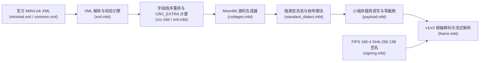

# `lycvvt/mavlink` 架构设计与协议数学规范 (`docs/plan.md`)

> **项目定位**：面向无人机（PX4 / ArduPilot）与地面站（GCS）通信的纯 MoonBit **MAVLink v2 / v1 协议栈与官方 XML 自动代码生成器**。

---

## 1. 系统总体架构

本项目采用**双层闭环架构**：底层提供零外部依赖的 MAVLink v2/v1 帧封装、X.25 CRC 校验、SHA-256 帧签名与流式状态机解析器；上层提供官方 `<mavlink>` XML 解析器、字段线序重排引擎与自举式（Self-Hosted）MoonBit 代码生成器。



---

## 2. MAVLink v2 帧结构与字节流数学规范

### 2.1 MAVLink v2 线上帧格式（12 ~ 280 字节）

```text
+------+------+-------+-------+-----+-------+--------+---------------+-----------+----------------+----------------+
| STX  | LEN  | INCMP | CMP   | SEQ | SYSID | COMPID | MSGID (24-bit)| PAYLOAD   | CHECKSUM (2B)  | SIGNATURE (13B)|
| 0xFD | 1B   | 1B    | 1B    | 1B  | 1B    | 1B     | 3B (LE)       | 0..255B   | X.25 CRC (LE)  | Optional       |
+------+------+-------+-------+-----+-------+--------+---------------+-----------+----------------+----------------+
```

- **STX**：MAVLink v2 固定为 `0xFD`；MAVLink v1 固定为 `0xFE`（6 字节帧头，8-bit `MSGID`）。
- **INCMP (`incompat_flags`)**：当最低位 `0x01`（`MAVLINK_IFLAG_SIGNED`）置位时，帧尾附加 13 字节签名块。
- **MSGID**：24-bit 无符号整数，按小端序（Little-Endian：`id & 0xFF`, `(id >> 8) & 0xFF`, `(id >> 16) & 0xFF`）编码，支持扩展消息（如 `LOGGING_ACK = 268`）。

### 2.2 字段按类型宽度重排规则（Wire Field Reordering）

为了避免嵌入式 C 编译器在结构体对齐时插入隐式填充字节（Padding），MAVLink 规范要求在序列化载荷与计算 `CRC_EXTRA` 前对字段进行确定性重排：

1. **基础字段（`<extensions/>` 之前）**：按字段**标量元素字节宽度**（`uint64_t/int64_t/double` = 8B，`uint32_t/int32_t/float` = 4B，`uint16_t/int16_t` = 2B，`uint8_t/int8_t/char` = 1B）**严格降序排列**；相同宽度的字段保持其在 XML 中声明的先后顺序（稳定排序）。注意：数组字段（如 `uint16_t[4]`）按其**单元素宽度（2B）**参与排序，而非数组总字节数。
2. **扩展字段（`<extensions/>` 之后）**：MAVLink v2 新增的扩展字段**不参与重排**，严格按 XML 声明顺序追加在所有基础字段末尾，以保证向后兼容。

### 2.3 ITU-T X.25 `CRC-16/MCRF4XX` 与 `CRC_EXTRA` 种子

校验和采用多项式 `0x1021`、初始值 `0xFFFF`、输入输出反转的 X.25 算法，单字节递推公式为：

$$
\text{tmp} = (b \oplus (\text{crc} \bmod 256)) \bmod 256, \quad
\text{tmp} = (\text{tmp} \oplus (\text{tmp} \ll 4)) \bmod 256
$$

$$
\text{crc}' = \left((\text{crc} \gg 8) \oplus (\text{tmp} \ll 8) \oplus (\text{tmp} \ll 3) \oplus (\text{tmp} \gg 4)\right) \bmod 65536
$$

- **`CRC_EXTRA` 计算**：对 `"<MSG_NAME> "` 及重排后的所有**基础字段**依次累积 `"<wire_type> <field_name> "`（若为定长数组则追加 1 字节数组长度 `array_len`），最终折叠为：
  $$\text{CRC\_EXTRA} = (\text{crc} \land \text{0xFF}) \oplus (\text{crc} \gg 8)$$
- **典型基准值验证**：
  - `HEARTBEAT (#0)` $\rightarrow \text{CRC\_EXTRA} = 50$
  - `SYS_STATUS (#1)` $\rightarrow \text{CRC\_EXTRA} = 124$
  - `GPS_RAW_INT (#24)` $\rightarrow \text{CRC\_EXTRA} = 24$
  - `ATTITUDE (#30)` $\rightarrow \text{CRC\_EXTRA} = 39$
  - `MISSION_ITEM_INT (#73)` $\rightarrow \text{CRC\_EXTRA} = 38$
  - `COMMAND_LONG (#76)` $\rightarrow \text{CRC\_EXTRA} = 152$
  - `STATUSTEXT (#253)` $\rightarrow \text{CRC\_EXTRA} = 83$

### 2.4 MAVLink v2 尾部零字节截断与零扩展（Zero-Trimming & Zero-Extension）

- **发送端截断**：MAVLink v2 序列化载荷后，从末尾向前扫描并剥离所有连续的 `0x00` 字节（但至少保留 1 字节，除非原始载荷为空），直接降低无线数传电台带宽开销。
- **接收端零扩展**：解码器读取载荷时，若偏移量超出实际接收的 `LEN`，自动补返回 `0x00`，从而透明兼容被截断的字段及旧版固件未发送的 `<extensions/>` 字段。

### 2.5 MAVLink v2 13 字节安全帧签名（SHA-256 Packet Signing）

当 `incompat_flags & 0x01 != 0` 时，发送端与接收端使用 32 字节共享密钥 `secret_key` 计算 FIPS 180-4 SHA-256 摘要：

$$
H = \text{SHA256}\left(\text{secret\_key}_{32\text{B}} \;\Vert\; \text{header}_{10\text{B}} \;\Vert\; \text{payload}_{N\text{B}} \;\Vert\; \text{crc}_{2\text{B}} \;\Vert\; \text{link\_id}_{1\text{B}} \;\Vert\; \text{timestamp}_{6\text{B, LE}}\right)
$$

取摘要前 6 字节 $H[0..6]$ 作为签名标签，并强制检查 48-bit 时间戳严格单调递增（防止无线重放攻击）。
